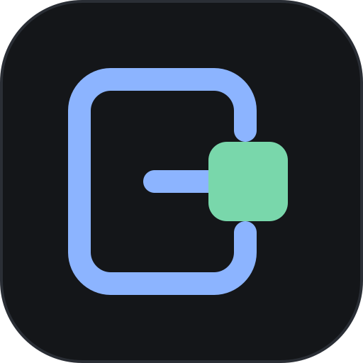
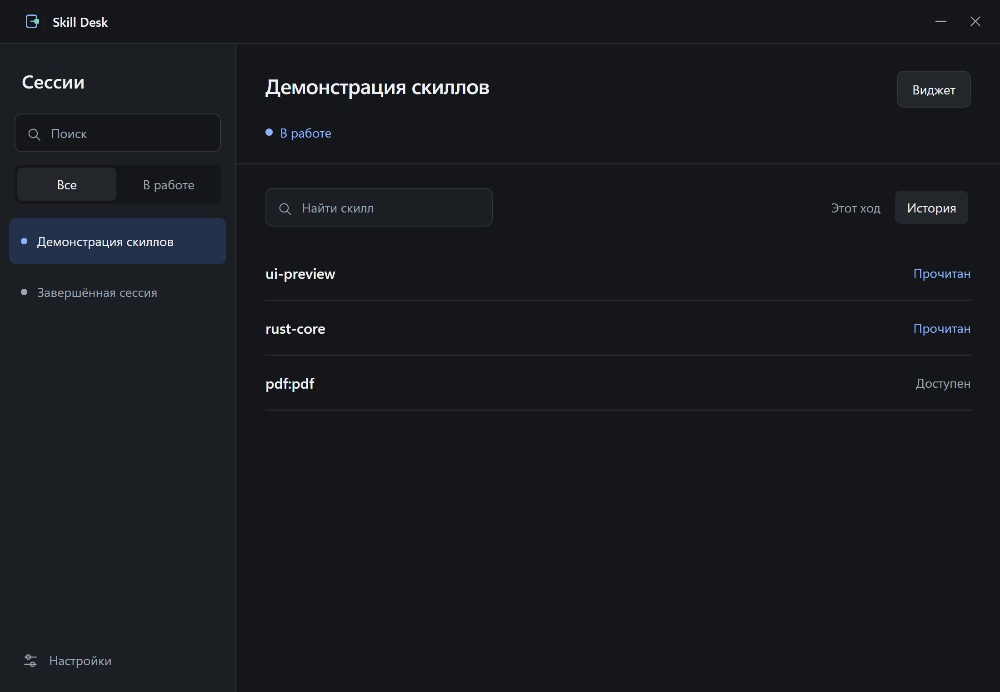
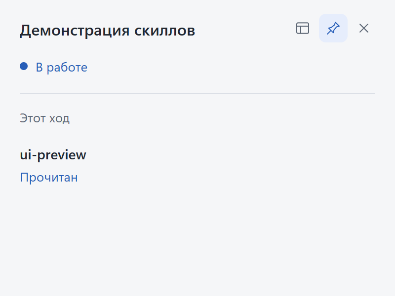

<div align="center">
  

  <h1>Skill Desk</h1>

  <p>Сессии Codex и их скиллы — на рабочем столе Windows.</p>

  <p>
    
    
    
    
  </p>

  <p><a href="https://github.com/B-a-t-0-n/skill-desk/releases/latest"><strong>Скачать для Windows</strong></a></p>
</div>



Skill Desk показывает доступные скиллы, чтение их инструкций и заявления агента об использовании. Выберите сессию или вынесите её в компактный виджет поверх других окон. Приложение читает локальные журналы Codex и обновляет данные каждые 3 секунды.

## Возможности

- Список сессий Codex с поиском и статусом работы.
- Скиллы выбранной сессии: доступность, чтение инструкций и заявления агента.
- Переключение между текущим ходом и историей; для завершённой сессии — последний ход.
- Отдельные виджеты с закреплением поверх окон.
- Светлая и тёмная темы, отображение субагентов, работа в трее.
- Сохранение настроек, открытых виджетов и положения окон.

<details>
  <summary>Компактный виджет</summary>

  <br>
  
</details>

На скриншотах показаны демонстрационные сессии.

## Установка

Скачайте приложение из [последнего релиза](https://github.com/B-a-t-0-n/skill-desk/releases/latest):

- **Установщик `.exe`** — установит приложение и при необходимости загрузит Microsoft Edge WebView2 Runtime.
- **SkillDesk-Windows-x64.zip** — переносная версия: распакуйте архив и запустите **SkillDesk.exe**. В архиве только приложение и README; нужен установленный WebView2 Runtime, который обычно уже есть в Windows 10/11.

Интерфейс работает в системном WebView2. Node.js и API-ключ не нужны.

В версии **0.6.0** приложение перенесено с Electron на **Rust + Tauri**, привычный интерфейс сохранён. Настройки из `%LOCALAPPDATA%\Skill Desk` подхватываются автоматически.

## Использование

Выберите сессию слева. Справа появятся её скиллы. Поиск помогает найти нужный скилл, а переключатель **«Этот ход / История»** меняет период отображаемых сигналов.

Кнопка **«Виджет»** открывает отдельное окно выбранной сессии. Его можно переместить, изменить размер и закрепить поверх окон. Тема, субагенты и сведения об источнике данных находятся в **«Настройках»**.

Закрытие главного окна скрывает приложение в трей. Для полного завершения выберите **«Выйти»** в меню значка Skill Desk. Закрытие виджета убирает только этот виджет.

### Что означают отметки

| Отметка | Что обнаружено в данных сессии |
| --- | --- |
| **Доступен** | Скилл указан в контексте сессии. |
| **Прочитан** | Зафиксировано успешное чтение его `SKILL.md`. |
| **Заявлен** | Агент явно сообщил об использовании скилла. |

Эти сигналы независимы. Наличие скилла, чтение файла и заявление агента не подтверждают выполнение каждой инструкции.

## Данные и ограничения

По умолчанию Skill Desk читает SQLite-базу сессий и JSONL-журналы из `%USERPROFILE%\.codex`. Если задан `CODEX_HOME`, используется эта папка. Файлы Codex открываются для чтения; приложение не вызывает модель и не требует API-ключа.

- Удалённые чаты без локального журнала не отображаются.
- Статус работы определяется по событиям журнала. Без свежего сигнала активный статус становится неизвестным через 10 минут.
- Внутренний формат данных Codex может меняться; после обновления Codex может потребоваться обновление Skill Desk.
- Настройки приложения сохраняются в `%LOCALAPPDATA%\Skill Desk`.

## Разработка

Версия 0.6.0 использует **Rust + Tauri 2.12**. Чтение SQLite и журналов, обработка сессий, настройки, окна и трей работают в Rust. Интерфейс — обычные HTML, CSS и JavaScript без сборщика и зависимостей npm. Node.js для сборки и работы приложения не требуется.

Для Windows нужны **Rust stable**, **Visual Studio Build Tools с компонентом «Разработка классических приложений на C++» и Windows SDK**, а также **Microsoft Edge WebView2 Runtime**. Подробности — в [требованиях Tauri](https://v2.tauri.app/start/prerequisites/#windows).

Проверка ядра и сборка переносимого приложения из папки проекта:

```powershell
cargo test --manifest-path src-tauri/Cargo.toml --no-default-features
cargo build --release --manifest-path src-tauri/Cargo.toml --bin SkillDesk
.\src-tauri\target\release\SkillDesk.exe
```

Для этой сборки CLI Tauri не нужен. Исполняемый файл появится в `src-tauri/target/release/SkillDesk.exe`.

### Разработка и установщик

Для режима разработки Tauri и создания установщика установите CLI один раз:

```powershell
cargo install tauri-cli --version '^2' --locked
cargo tauri dev
cargo tauri build
```

Установщик NSIS появится в `src-tauri/target/release/bundle/nsis`.

Предпросмотр интерфейса в браузере:

```powershell
cargo run --manifest-path src-tauri/Cargo.toml --no-default-features --example skill-desk-data -- --preview
```

Откройте `http://127.0.0.1:47832`. Предпросмотр показывает локальные сессии; окна, виджеты и трей проверяются в приложении.

Для отдельной папки данных или профиля можно задать переменные перед запуском:

```powershell
$env:SKILL_DESK_CODEX_HOME = 'C:\path\to\codex-data'
$env:SKILL_DESK_PROFILE = 'C:\path\to\skill-desk-profile'
cargo tauri dev
```

`SKILL_DESK_CODEX_HOME` имеет приоритет над `CODEX_HOME`. Путь `SKILL_DESK_PROFILE` должен быть абсолютным.

### Проверки

Тесты Rust проверяют обработку сессий, чтение данных и сохранение настроек. В них включены 52 сценария совместимости с парсером версии на Electron.

Дополнительные проверки требуют **Node.js 24+**; установка пакетов npm не нужна:

```powershell
npm run test:parity
cargo build --manifest-path src-tauri/Cargo.toml --bin SkillDesk
npm run test:desktop
```

`test:parity` запускает прежние регрессионные сценарии против Rust, `test:desktop` проверяет настоящее приложение Tauri/WebView2 на демонстрационных данных.

---

Палитра и характер компонентов вдохновлены [pipeline-desk](https://github.com/B-a-t-0-n/pipeline-desk).
